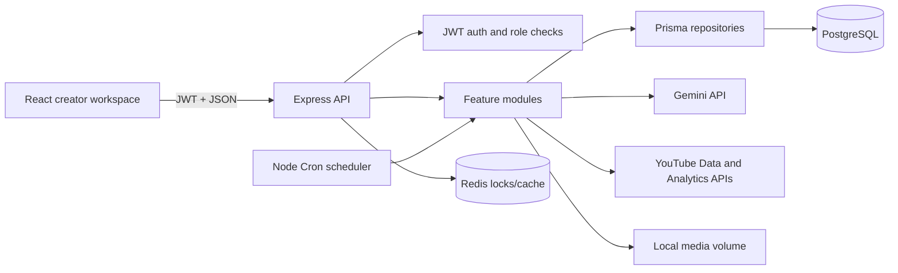

# Architecture and Operations

## Request flow

The API returns `{ success, data }` envelopes and a stable `{ success: false, error: { code, message } }` error shape. The browser Axios client unwraps successful envelopes. Refresh tokens are random, one-time-rotated values stored as keyed hashes and delivered in httpOnly, secure-in-production cookies. Access JWTs are short-lived. YouTube access/refresh credentials are AES-256-GCM encrypted at rest with `TOKEN_ENCRYPTION_KEY`.

## Persistence and migrations

`backend/prisma/schema.prisma` is the data model source. The checked-in initial migration lives under `backend/prisma/migrations/202609270001_initial_schema`. For local schema work use `npm run db:migrate`; for deployed environments run `npm run db:deploy`. Seed data is opt-in and requires explicit administrator credentials through `SEED_ADMIN_EMAIL` and `SEED_ADMIN_PASSWORD`.

## Scheduler

The scheduler checks each account's `Settings.uploadTime` and `Settings.timezone` once per minute, limits runs using `dailyUploadLimit`, creates prompt history and generated-video records, then queues due YouTube uploads. Redis `SET NX EX` locks prevent duplicate daily runs across API replicas; when Redis is unavailable a process-local lock is used and a warning is logged. Production deployments should keep Redis available when running multiple backend replicas.

## OAuth and credentials

Create a Google OAuth client with YouTube upload and YouTube Analytics scopes. Set its client ID, client secret, and exact redirect URI in backend environment configuration. The channel connect API exchanges the one-time OAuth code server-side. Never send Google client secrets, Gemini API keys, or YouTube tokens to the browser. Restrict CORS to the deployed frontend origin and terminate TLS at the edge so auth cookies are secure.

## Operational boundaries

- PostgreSQL is required for API startup; Redis is recommended for distributed scheduler locks.
- Gemini generation and YouTube upload are external, long-running operations. API generation requests return `202` and the video record can be polled from `GET /api/videos`.
- Files are stored in `UPLOAD_DIR`; container deployments mount a persistent volume. A production object-storage adapter can replace the local storage service without changing module contracts.
- Logs are structured JSON outside development. Forward stdout/stderr to the deployment log collector; do not log OAuth secrets, passwords, JWTs, or refresh tokens.
- Configure API rate limits, reverse-proxy request sizes, backups, database TLS, key rotation, and alerting for the target environment before public deployment.